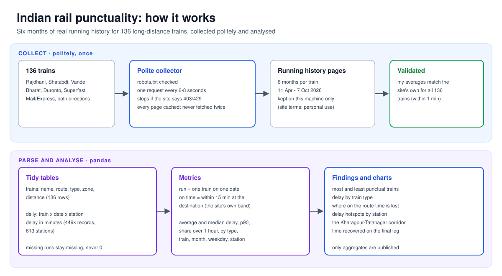
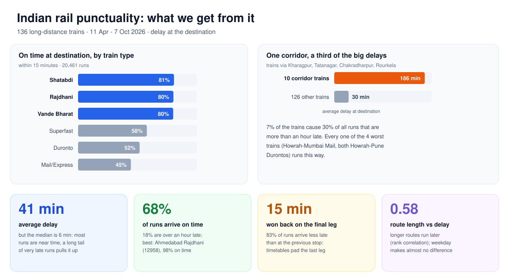
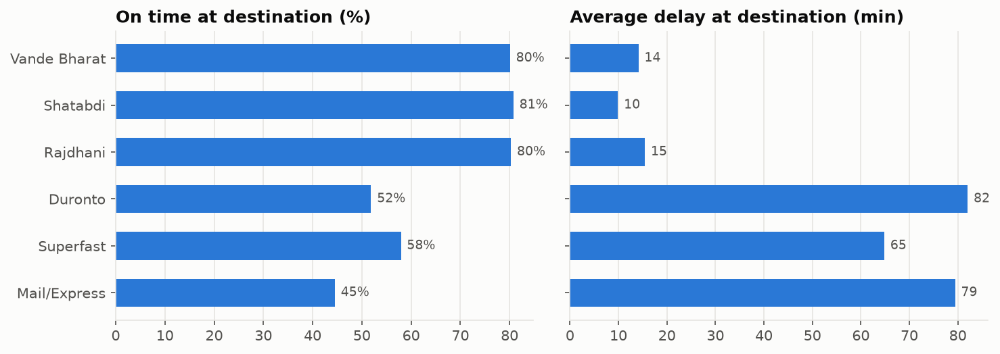
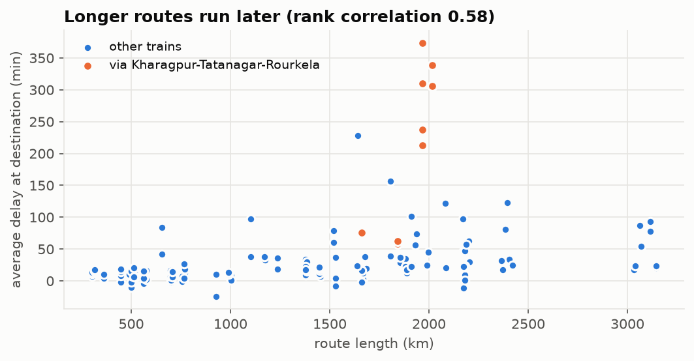
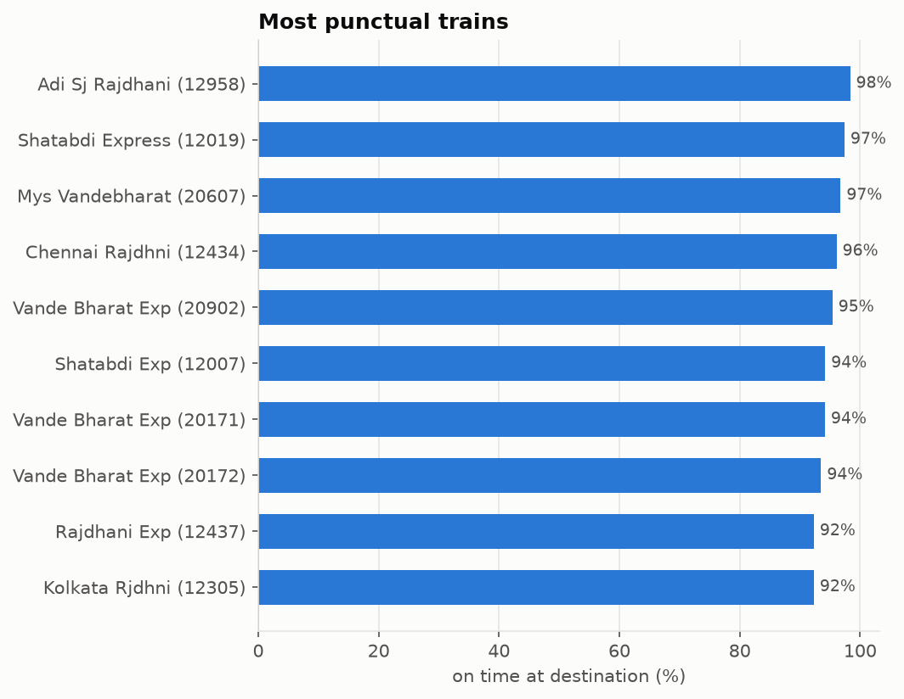
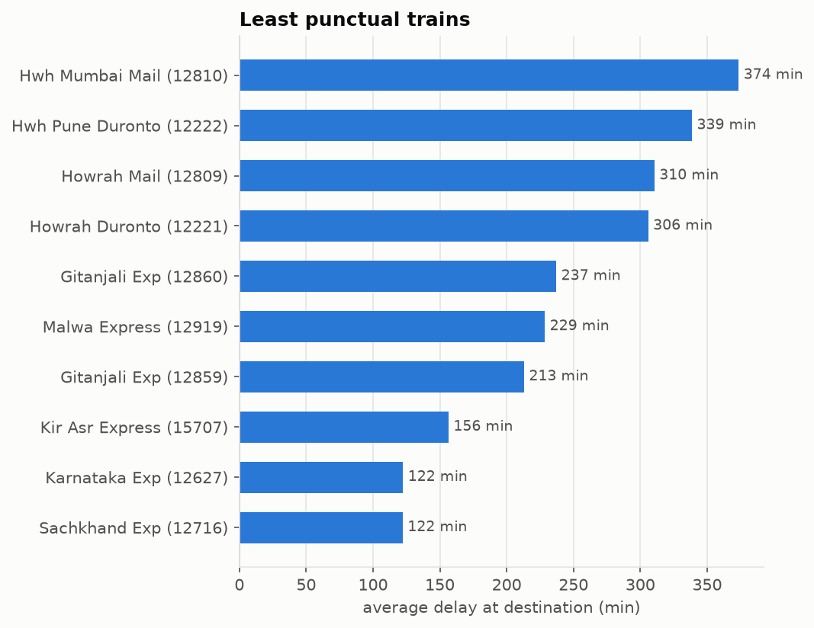
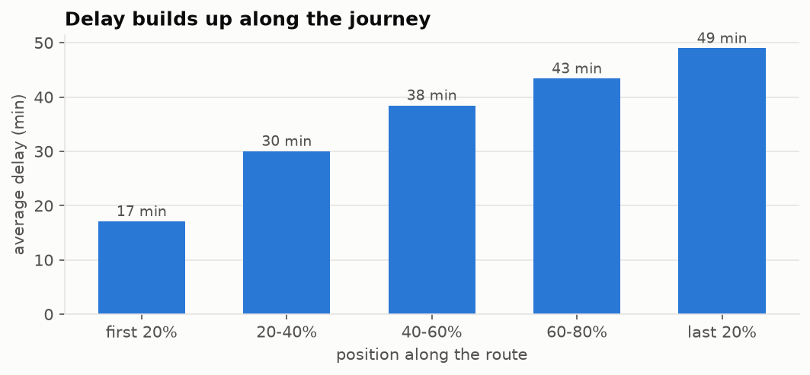
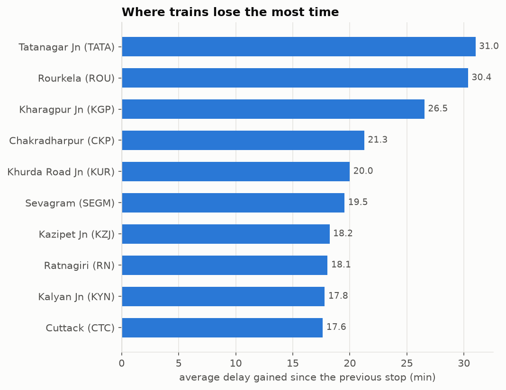
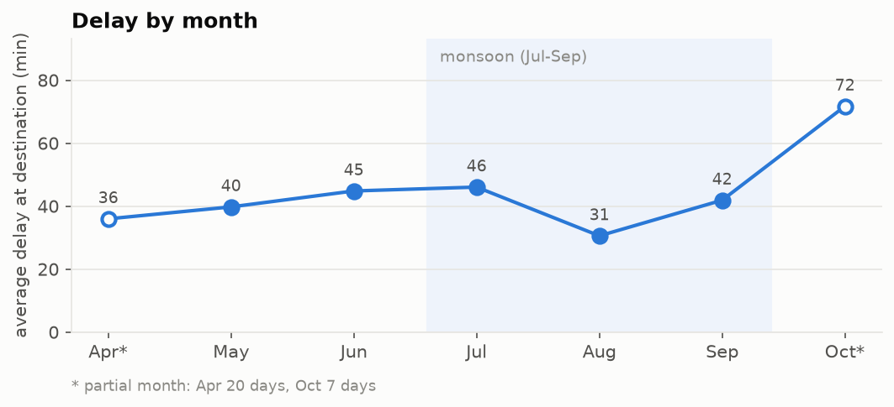
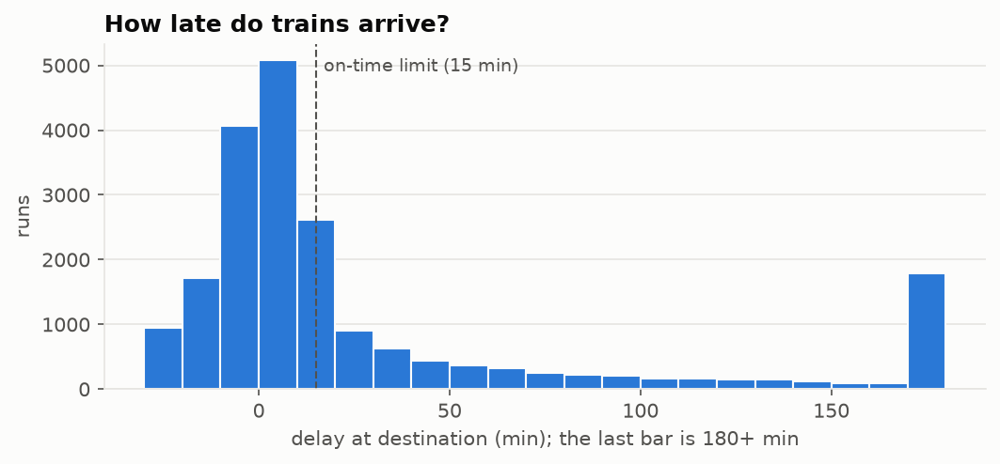

# 🚆 How late are India's long-distance trains?

**Six months of real running history for 136 long-distance trains (20,461 runs, 449k station records), collected politely and analysed.** Which trains run on time, which don't, where on the network time is lost, and why some trains arrive early.


> Inspired by checking *Where is my Train* on every journey and wondering: is my train usually this late, or is it just today?

---

## How it works



## What we get from it



## Findings

Period: **11 Apr to 7 Oct 2026**. A *run* is one train on one date; delay is measured **at the destination**; *on time* means within 15 minutes, the source's own "Right Time" band.

| | |
|---|---|
| Average delay at destination | **41 min** (median **6 min**, 90th percentile **144 min**) |
| Runs on time (≤ 15 min) | **68%** |
| Runs more than an hour late | **18%** |
| Runs with no record (cancelled / unknown) | 0.2%, counted separately, never as zero |

### 1. Premium trains are on time 4 times out of 5; the rest are a coin flip



Shatabdi, Rajdhani and Vande Bharat trains all arrive on time about **80%** of the time and average 10-16 minutes late. Superfast, Duronto and Mail/Express trains manage **45-58%** and average 65-82 minutes. The Durontos are a surprise: sold as fast non-stop trains, they are on time only half the time.

### 2. One corridor causes a third of the long delays



All four least punctual trains (Howrah-Mumbai Mail both ways, Howrah-Pune Duronto both ways) run through the **Kharagpur - Tatanagar - Chakradharpur - Rourkela** stretch, and those junctions top the list of places where trains lose time.

| | Trains | Average delay | On time | Share of all 1h+ late runs |
|---|---|---|---|---|
| Via Kharagpur-Tatanagar-Rourkela | 10 | **186 min** | **18%** | **30%** |
| All other trains | 126 | 30 min | 72% | 70% |

Route length matters too, separately: longer routes run later (rank correlation **0.58**, and 0.56 with the corridor excluded).

| Most punctual | Least punctual |
|---|---|
|  |  |

### 3. Delay builds up along the route, then timetables win some back



Trains average 17 minutes late in the first fifth of the trip and 49 minutes in the last fifth. Then something interesting happens on the final leg: **83% of runs arrive less late than they were at the previous stop**, recovering **15 minutes** on average. Timetables pad the last section. It's why the Ahmedabad Rajdhani (12958) averages **24 minutes early** and is on time 98% of the time.

### 4. Where trains lose time



Average delay *gained* arriving at each station compared with the previous recorded stop (stations with at least 200 observations).

### 5. Season and weekday



The monsoon months were **not** worse in this sample: August was the best month (31 min). October looks bad (72 min) but covers only 7 days, so it is marked partial. Weekday makes almost no difference (38-44 min every day).

<details>
<summary>How late do trains arrive? (distribution)</summary>



Most runs arrive within a few minutes of time; a long tail of very late runs pulls the average (41 min) far above the median (6 min).
</details>

## Data and method

- **Source:** train running history pages on [etrain.info](https://etrain.info), which publish per-day delay at each major stop. *Where is my Train* itself has no public data, and the dataset from the [RSTGCN paper](https://arxiv.org/abs/2510.01262) is not released yet.
- **Collected politely:** `robots.txt` allows these pages; one request every 6-8 seconds with a descriptive User-Agent; every page cached so nothing is fetched twice; the collector stops if the site returns 403/429. 138 trains requested, 136 collected, 2 not on the source (Kalka Mail 12311/12312).
- **Not redistributed:** the site's terms are personal, non-commercial use. This repo publishes the code and aggregate findings only; the raw pages and the extracted dataset stay local (`data/` is git-ignored). Run the collector to rebuild them.
- **Validated:** for all 136 trains, my per-train average delay at the destination matches the site's own published average within 1 minute.
- **Limits:** the source records major stops only, not every station; delays are as reported by the source; 136 well-known trains are not a random sample of Indian Railways; 6 months is one season cycle, not a trend.

## Quick start

```bash
git clone https://github.com/abpandey-dev/rail-punctuality.git && cd rail-punctuality
python -m venv .venv && source .venv/bin/activate
pip install -e ".[dev]"
pytest -q                                   # 9 tests on hand-made fixtures, no network

python -m railstats.collect                 # ~35 min: 136 trains, 6-8 s between requests, cached
python scripts/make_report.py               # tables -> data/, charts -> docs/images/, findings printed
```

## Project layout

```text
src/railstats/
  trains.py      # the 138 train numbers (names, routes and types come from the source pages)
  collect.py     # polite, cached, stop-on-403/429 collector
  parse.py       # pages -> trains / daily delays / station stats tables
  analysis.py    # runs, on-time %, rankings, route stages, hotspots, corridor, final-leg recovery
  charts.py      # matplotlib charts
scripts/make_report.py
docs/            # how-it-works and what-we-get diagrams, charts
tests/           # parser and metric tests on hand-made data
```

## Next steps

- Re-run monthly to build a longer history and see whether the corridor improves.
- Predict tomorrow's delay for a given train from its recent runs (and compare with simply using yesterday's delay).
- An "ask the data" assistant: plain-English questions such as "is the Gitanjali usually late at Nagpur?" answered from these tables.
